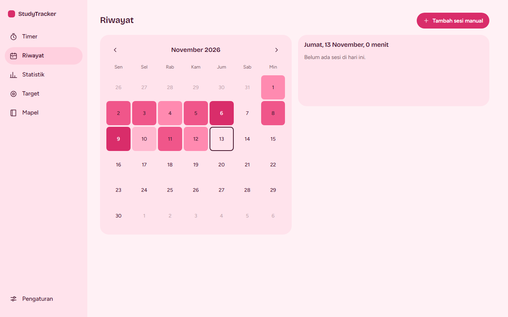

# StudyTracker

Pelacak waktu belajar pribadi untuk desktop. Catat sesi per mata pelajaran, lihat riwayat
dan statistik, pasang target harian/mingguan, dan pantau hitung mundur ujian. Semua data
tersimpan lokal di komputer kamu, tanpa akun dan tanpa server.

Dibangun dengan Tauri 2, Rust, dan Svelte 5. Spesifikasi produk ada di
[`APP_SPEC.md`](APP_SPEC.md), spesifikasi tampilan ada di [`UI_UX_SPEC.md`](UI_UX_SPEC.md).


## Isi

- **Timer** — satu tombol besar, chip mata pelajaran, tiga keadaan panel (Diam, Berjalan, Jeda).
  Berhenti langsung menyimpan sesi, tanpa dialog.
- **Riwayat** — kalender bulan dengan skala heatmap, daftar sesi per hari, tambah/ubah/hapus manual.
- **Statistik** — rentang Hari/Minggu/Bulan, ringkasan satu kalimat, grafik batang bertumpuk per
  mata pelajaran, rincian per mapel, heatmap 26 minggu, streak dan rekor.
- **Target** — target harian dan mingguan, daftar D-day dengan hitung mundur.
- **Mata pelajaran** — delapan warna, arsip untuk mapel yang sudah punya sesi.
- **Pengaturan** — tema, skala antarmuka, awal hari belajar, deteksi idle, pintasan global,
  perilaku jendela, ekspor/impor data.
- **Integrasi desktop** — ikon tray yang mengikuti keadaan timer, menu tray, mini mode,
  pintasan global, satu instance, mulai saat komputer menyala.

## Tangkapan layar

| Riwayat | Statistik |
| --- | --- |
|  |  |

## Prasyarat

- **Node.js 20+** dan npm (dipakai untuk membangun frontend).
- **Rust stable** (`rustup`) — perlu untuk menjalankan aplikasi desktop.
- **Windows**: Visual Studio Build Tools dengan beban kerja *Desktop development with C++*
  dan WebView2 Runtime (sudah ada di Windows 11).
- **Linux**: `libwebkit2gtk-4.1-dev`, `libappindicator3-dev`, `librsvg2-dev`, `build-essential`.
- **macOS**: Xcode Command Line Tools.

## Menjalankan

```bash
# sekali saja: dependensi CLI Tauri di akar repo, lalu dependensi frontend
npm install
npm --prefix ui install

# aplikasi desktop (hot reload frontend + rebuild Rust otomatis)
npm run tauri dev

# hanya jendela aplikasi untuk build terpaket
npm run tauri build
```

Perintah pertama kali akan mengunduh crate Rust, jadi wajar makan beberapa menit.
Hasil installer ada di `src-tauri/target/release/bundle/`.

### Hanya frontend

```bash
npm run dev      # http://localhost:1420
```

Kalau dibuka di browser tanpa Tauri, frontend memakai backend tiruan berbasis
`localStorage` (`ui/src/lib/devmock.ts`) supaya layar tetap bisa dilihat dan diklik. Mode ini
khusus pratinjau desain: tidak ada file database, tidak ada tray, dan mini mode menampilkan
pesan "Tidak tersedia di mode pratinjau".

### Pemeriksaan

```bash
npm run check    # svelte-check, 0 error
npm run test     # vitest (11 tes format)
npm run build    # build produksi frontend
cargo test -p studytracker-core   # tes logika core (butuh toolchain Rust)
cargo check --workspace --all-targets
```

## Struktur repo

```
crates/core/        logika bisnis murni: model, timer, agregasi statistik, SQLite, ekspor/impor
src-tauri/          lapisan desktop: command, tray, idle monitor, jendela mini, main
  icons/            ikon aplikasi dan ikon tray (hasil scripts/gen-icons.mjs)
ui/                 frontend Svelte 5
  src/lib/          api, store, i18n, format, komponen
  src/routes/       Timer, History, Stats, Targets, Subjects, Settings, Mini
  src/styles/       token desain dan CSS dasar
scripts/            gen-icons.mjs (pembuat ikon PNG/ICO tanpa dependensi)
.github/workflows/  CI: frontend (check, test, build) dan Rust (test core, check workspace)
```

Aturan yang dipegang: **tidak ada logika bisnis di frontend atau di `src-tauri`**. Command
Tauri hanya memanggil `studytracker-core`, lalu menyiarkan `session-changed`.

## Penyimpangan dari spesifikasi

Semua penyimpangan berikut disengaja dan alasannya ditulis di sini.

| Penyimpangan | Alasan |
| --- | --- |
| Plugin `tauri-plugin-dialog` ditambahkan | Ekspor dan impor butuh dialog simpan/buka bawaan OS. Tanpa plugin ini pengguna harus mengetik path sendiri. |
| Grafik batang dan heatmap digambar sendiri (div + CSS), tanpa pustaka grafik | Kebutuhannya kecil (batang bertumpuk, grid horizontal, tooltip). Menggambar sendiri menghindari dependensi baru dan menjaga bobot bundel. |
| Ikon Lucide disalin sebagai path SVG di `ui/src/lib/icons.ts` | Spesifikasi melarang emoji sebagai ikon. Menyalin path membuat tidak perlu paket ikon tambahan. |
| Font di-self-host lewat `@fontsource` | Aplikasi desktop harus jalan tanpa internet; tidak boleh memuat font dari CDN. |
| Token `--on-heat` dan `--on-heat-strong` ditambahkan | Warna heatmap tetap pink di kedua tema, jadi teks di atasnya harus dipatok gelap/putih. Nilainya sama dengan `--plum` dan `--paper` tema terang — tidak ada hex baru, hanya token turunan supaya kontras sel heatmap tidak rusak saat tema gelap. |
| Ikon PNG/ICO dibuat oleh `scripts/gen-icons.mjs` | Tidak menambah dependensi pengolah gambar. Jalankan ulang skrip ini setelah mengubah desain ikon. |
| Deteksi tidur komputer belum diimplementasikan | Pengaturan "Hitung waktu saat komputer tidur" tersimpan, tetapi belum memengaruhi perhitungan. Lihat bagian batasan. |

## Batasan yang masih terbuka

Jujur, ini yang belum beres:

1. **Kode Rust belum pernah dikompilasi di mesin ini.** Mesin penyusun tidak punya `cargo`
   maupun `rustc`, jadi `crates/core` dan `src-tauri` ditulis mengikuti API Tauri 2 dan
   SQLite (rusqlite) tanpa verifikasi kompilasi. Frontend sudah lolos `svelte-check`,
   `vitest`, dan `build`. Langkah pertama di mesin lain: `cargo test` lalu `cargo tauri dev`.
2. **Deteksi idle** memantau input keyboard/mouse Windows lalu memunculkan dialog "Sesi belum
   selesai" dengan pilihan jam selesai, tetapi belum diuji di aplikasi sungguhan.
3. **Hitung waktu saat komputer tidur**: belum ada. Sesi yang berjalan saat komputer tidur
   akan menghitung waktu tidur sebagai waktu belajar, dan sakelar di Pengaturan belum tersambung.
4. **Pintasan global** (`Ctrl+Alt+S` sebagai bawaan) didaftarkan lewat plugin; perilakunya
   belum dicoba di OS sungguhan.
5. **Notifikasi target tercapai** baru berupa toast di dalam aplikasi; notifikasi sistem belum
   dipasang ke kejadian apa pun.
6. **Kontras sel kalender heat-3** (`--heat-3` dengan teks `--plum`) sekitar 4,3:1, sedikit di
   bawah target 4,5:1. Untuk mencapai 4,5:1 perlu menggelapkan `--heat-3` atau memakai teks
   putih, dan keduanya mengubah tangga warna heatmap — perlu keputusan desain.
7. **Input jam** memakai `<input type="time">` bawaan, jadi formatnya mengikuti locale OS
   (bisa 09.00 atau 9:00 AM), sementara teks lain memakai format Indonesia.
8. **`Cargo.lock` belum ada** karena belum pernah ada resolusi dependensi di mesin ini.
   Commit file itu setelah build pertama supaya versi crate terkunci.

## Lisensi

MIT.
