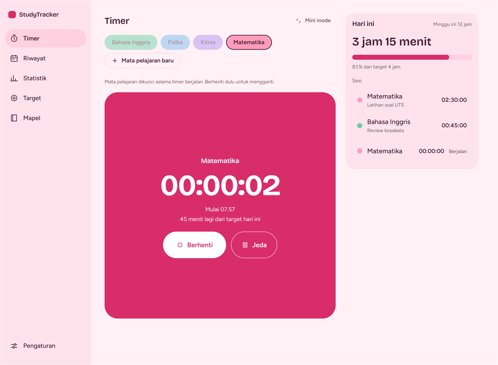
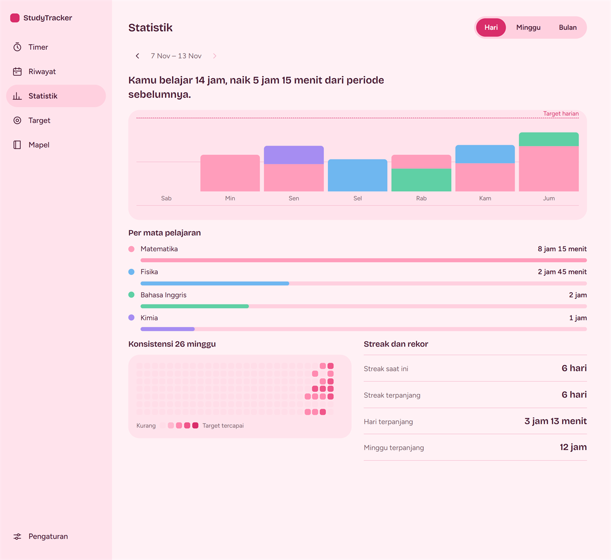
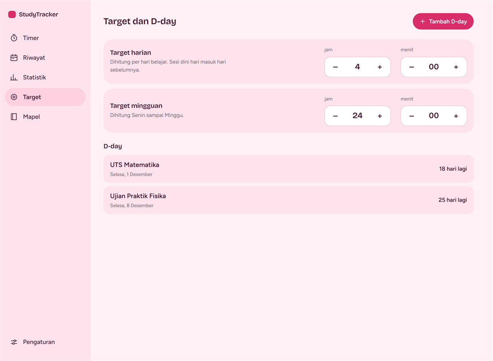
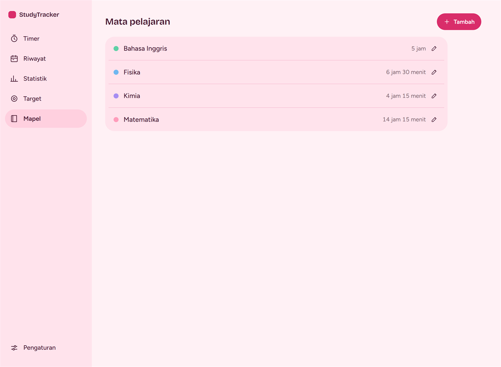
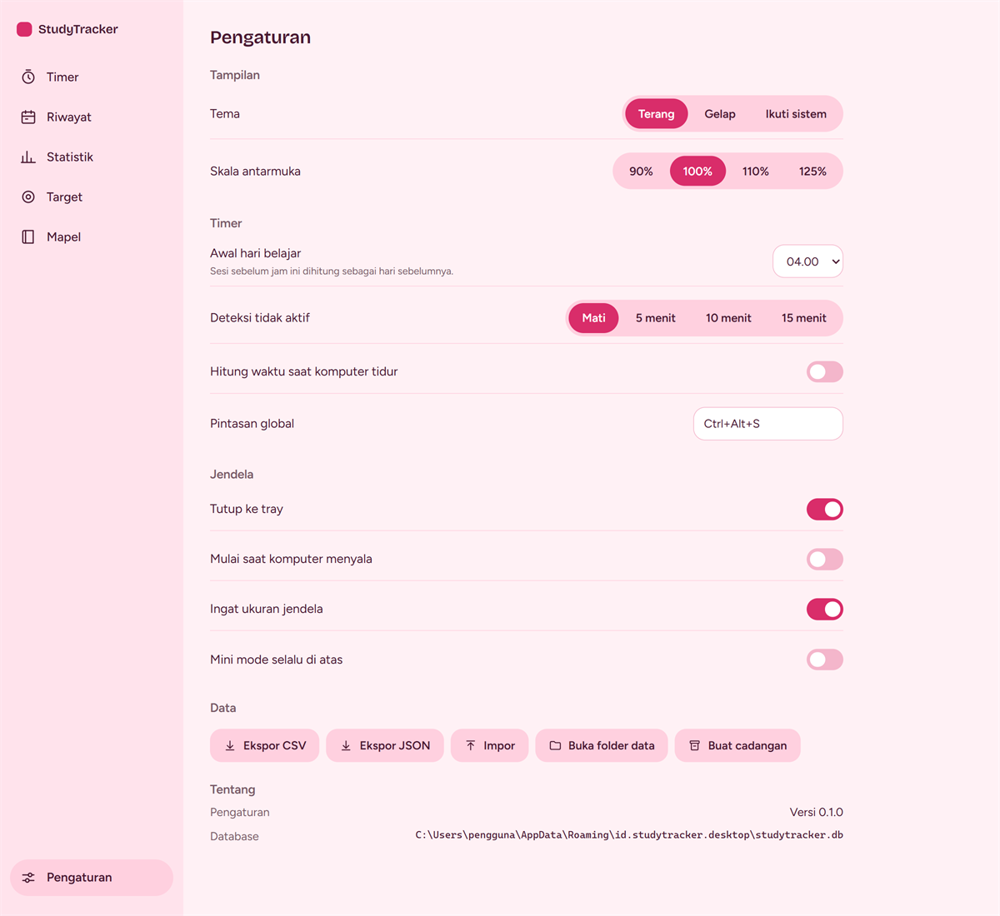
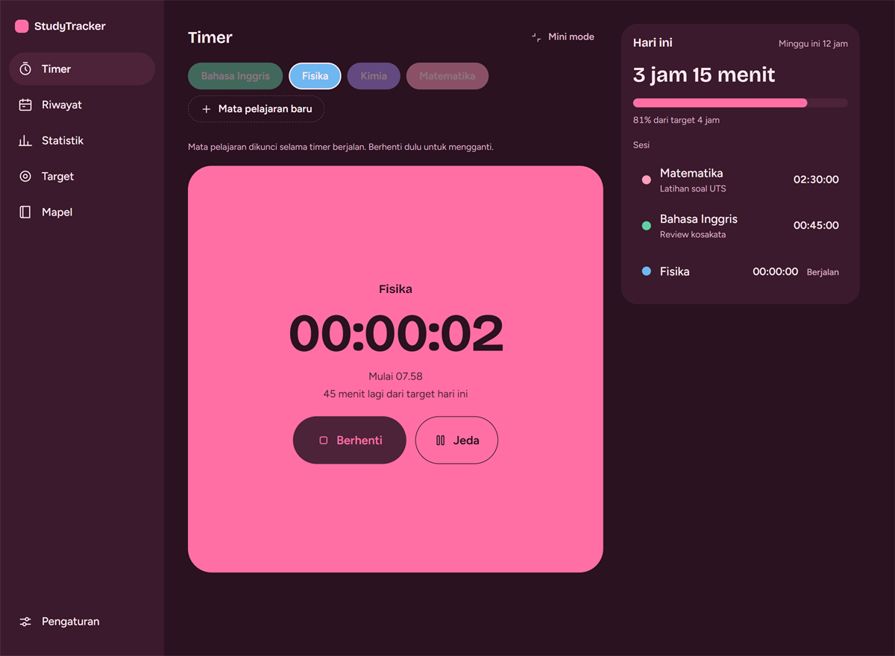
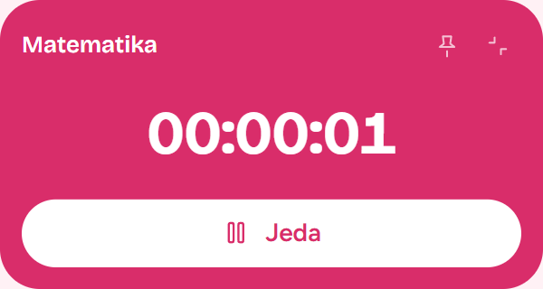

<p align="center">
  
</p>

<h1 align="center">StudyTracker</h1>

<p align="center">
  <b>Pelacak waktu belajar pribadi untuk desktop.</b><br>
  Catat sesi per mata pelajaran, lihat riwayat dan statistik, kejar target harian, dan pantau hitung mundur ujian.<br>
  Semua data tinggal di komputer kamu — tanpa akun, tanpa server, tanpa iklan.
</p>

<p align="center">
  <a href="../../releases/latest"></a>
  
  
  
  
  
</p>

---

## Fitur

| | |
| --- | --- |
| **Timer satu tombol** | Mulai, jeda, lanjut, berhenti. Berhenti langsung menyimpan sesi — tanpa dialog, dengan tombol *Urungkan* selama 8 detik. Panel berganti warna sesuai keadaan: diam, berjalan, jeda. |
| **Riwayat per hari** | Kalender bulan dengan skala intensitas seperti heatmap, daftar sesi per hari beserta rentang jam dan catatan. Sesi bisa ditambah, diubah, atau dihapus manual. |
| **Statistik yang jujur** | Rentang hari/minggu/bulan, satu kalimat ringkasan, grafik batang bertumpuk per mata pelajaran, rincian per mapel, heatmap 26 minggu, streak, dan rekor pribadi. |
| **Target & D-day** | Target harian dan mingguan dalam jam dan menit, plus daftar ujian dengan hitung mundur. Progres target muncul sebagai bar di panel "Hari ini". |
| **Mata pelajaran** | Delapan warna pastel, arsip untuk mapel yang sudah punya riwayat, total waktu per mapel. |
| **Integrasi desktop** | Ikon tray yang mengikuti keadaan timer, menu tray (mulai/jeda, berhenti, mini mode, keluar), mini mode 300×160 yang selalu bisa di atas, pintasan global `Ctrl+Alt+S`, satu instance, dan opsi mulai saat komputer menyala. |
| **Data milikmu** | SQLite lokal, ekspor JSON/CSV, impor, dan cadangan sekali klik. Tidak ada telemetri. |

## Unduh & pasang

Semua berkas ada di halaman **[Rilis terbaru](../../releases/latest)**. Pilih salah satu:

| Berkas | Untuk siapa | Catatan |
| --- | --- | --- |
| `StudyTracker_0.1.0_x64-setup.exe` | **Paling praktis** (disarankan) | Installer NSIS. Memasang untuk pengguna saat ini, membuat pintasan Start Menu, dan mendaftarkan entri *Uninstall*. |
| `StudyTracker_0.1.0_x64_en-US.msi` | Pemasangan terkelola | MSI untuk dipasang lewat kebijakan organisasi, `msiexec`, atau alat penyebaran. |
| `StudyTracker_0.1.0_x64_portable.zip` | Tanpa instalasi | Cukup ekstrak, lalu jalankan `studytracker.exe`. Tidak menyentuh Start Menu dan tidak punya uninstaller. |

**Persyaratan:** Windows 10 atau 11, 64-bit. WebView2 Runtime sudah tersedia di Windows 11 dan sebagian besar Windows 10; kalau belum ada, installer otomatis memandu pemasangannya.

<details>
<summary>Cara memasang lewat terminal, atau memasang tanpa dialog</summary>

```powershell
# Installer NSIS, senyap (tanpa dialog)
.\StudyTracker_0.1.0_x64-setup.exe /S

# MSI
msiexec /i .\StudyTracker_0.1.0_x64_en-US.msi /qn
```

</details>

> **Peringatan Windows SmartScreen.** Aplikasi ini belum ditandatangani dengan sertifikat code signing berbayar, jadi saat pertama kali dijalankan Windows bisa menampilkan *"Windows protected your PC"*. Klik **More info → Run anyway**. Ini normal untuk aplikasi sumber terbuka tanpa sertifikat; kode sumbernya bisa kamu periksa sendiri di repo ini.

### Setelah terpasang

- Aplikasi terpasang di `%LOCALAPPDATA%\StudyTracker`. Pintasan ada di Start Menu.
- **Data belajar** disimpan di `%APPDATA%\id.studytracker.desktop\studytracker.db`. Jalankan *Buat cadangan* di Pengaturan sebelum mengubah apa pun, atau salin foldernya saat aplikasi tertutup.
- *Uninstall* lewat **Pengaturan → Aplikasi → StudyTracker**. Uninstaller tidak menghapus database; hapus folder di atas manual kalau ingin benar-benar bersih.
- Menutup jendela berarti sembunyi ke tray. Keluar sepenuhnya lewat menu tray → **Keluar**.

## Tangkapan layar

| Riwayat | Statistik |
| :---: | :---: |
|  |  |

| Target & D-day | Mata pelajaran |
| :---: | :---: |
|  |  |

| Pengaturan | Tema gelap |
| :---: | :---: |
|  |  |

<p align="center">
  <br>
  <sub>Mini mode: timer dalam jendela kecil, bisa dipin di atas jendela lain.</sub>
</p>

## Pintasan keyboard

| Tombol | Aksi |
| --- | --- |
| `Spasi` | Mulai / jeda timer |
| `Ctrl` + `Enter` | Berhenti dan simpan sesi |
| `Ctrl` + `1` … `6` | Pindah layar (Timer, Riwayat, Statistik, Target, Mapel, Pengaturan) |
| `Esc` | Tutup dialog |
| `Ctrl` + `Alt` + `S` | Mulai / jeda dari mana saja (pintasan global, bisa diubah) |

## Cara kerjanya

Seluruh logika bisnis ada di `crates/core` dan diuji tanpa UI: model, timer, agregasi statistik, SQLite, ekspor/impor. `src-tauri` hanya menjembatani — menerima command, memanggil core, menyiarkan event `session-changed`. Frontend Svelte 5 tidak pernah menghitung durasi atau statistik sendiri; ia hanya menampilkan angka yang berdetak.

```
crates/core/        logika murni: model, timer, statistik, SQLite, ekspor/impor, cadangan
src-tauri/          lapisan desktop: command, tray, deteksi idle, mini mode, pembaruan state
  icons/            ikon aplikasi dan ikon tray (hasil scripts/gen-icons.mjs)
ui/                 frontend Svelte 5
  src/lib/          api, store, i18n, format, komponen
  src/routes/       Timer, Riwayat, Statistik, Target, Mapel, Pengaturan, Mini
  src/styles/       token desain dan CSS dasar
scripts/            gen-icons.mjs — pembuat ikon PNG/ICO tanpa dependensi
docs/               tangkapan layar untuk README
```

Beberapa keputusan yang disengaja: font di-*self-host* lewat `@fontsource` supaya aplikasi tetap rapi tanpa internet; grafik dan heatmap digambar sendiri dengan `div` + CSS agar tidak menambah pustaka; ikon SVG disalin sebagai path, bukan paket ikon; dan tidak ada emoji di antarmuka.

## Pengembangan

**Prasyarat:** Node.js 20+ dan npm, Rust *stable* (`rustup`), serta di Windows: Visual Studio Build Tools dengan beban kerja *Desktop development with C++* dan Windows SDK. Di Linux: `libwebkit2gtk-4.1-dev`, `libappindicator3-dev`, `librsvg2-dev`, `build-essential`. Di macOS: Xcode Command Line Tools.

```bash
npm install            # CLI Tauri
npm --prefix ui install # dependensi frontend

npm run tauri dev      # aplikasi desktop + hot reload
npm run tauri build    # build produksi + installer
```

Hasil build: `target/release/bundle/nsis/` dan `target/release/bundle/msi/`.

### Hanya frontend

```bash
npm run dev   # http://localhost:1420
```

Dibuka di browser, frontend memakai backend tiruan berbasis `localStorage` (`ui/src/lib/devmock.ts`) supaya setiap layar bisa diklik tanpa Rust. Mode ini hanya untuk pratinjau desain: tidak ada database, tray, atau mini mode sungguhan.

### Pemeriksaan

```bash
npm run check                     # svelte-check
npm test                          # vitest (format angka, jam, durasi)
npm run build                     # build produksi frontend
cargo test -p studytracker-core   # 44 tes logika core
cargo check --workspace --all-targets
```

CI menjalankan semua perintah di atas pada setiap push ke `main` dan setiap pull request.

### Merilis versi baru

1. Naikkan `version` di `src-tauri/tauri.conf.json` dan `ui/package.json`.
2. Commit, lalu buat tag: `git tag v0.1.0 && git push origin v0.1.0`.
3. Workflow **Rilis** membangun aplikasi di runner Windows, menerbitkan GitHub Release, dan melampirkan installer NSIS, MSI, portable ZIP, serta berkas `SHA256SUMS.txt`.

Untuk memeriksa unduhan:

```powershell
Get-FileHash .\StudyTracker_0.1.0_x64-setup.exe -Algorithm SHA256
# bandingkan dengan isi SHA256SUMS.txt di halaman rilis
```

## Yang belum ada

Ditulis terbuka supaya tidak ada kejutan:

- **Hitung waktu saat komputer tidur** belum tersambung — sakelarnya tersimpan, tetapi sesi tetap menghitung waktu tidur sebagai waktu belajar.
- **Deteksi tidak aktif** hanya berjalan di Windows. Di Linux dan macOS fungsi itu mengembalikan nol, jadi dialog "Sesi belum selesai" tidak muncul sendiri.
- **Installer resmi hanya untuk Windows x64.** Linux dan macOS bisa dibangun dari sumber, tetapi belum diuji dan belum punya paket.
- **Input jam** memakai `<input type="time">` bawaan sistem, jadi formatnya mengikuti bahasa OS (misalnya `09.00` atau `9:00 AM`), sementara teks lain memakai format Indonesia.

## Lisensi

[MIT](LICENSE). Pakai, ubah, dan sebarkan bebas dengan mencantumkan lisensinya.

<p align="center">
  <sub>Dibuat dengan Rust, Tauri 2, dan Svelte 5. Tidak ada data yang keluar dari komputermu.</sub>
</p>
